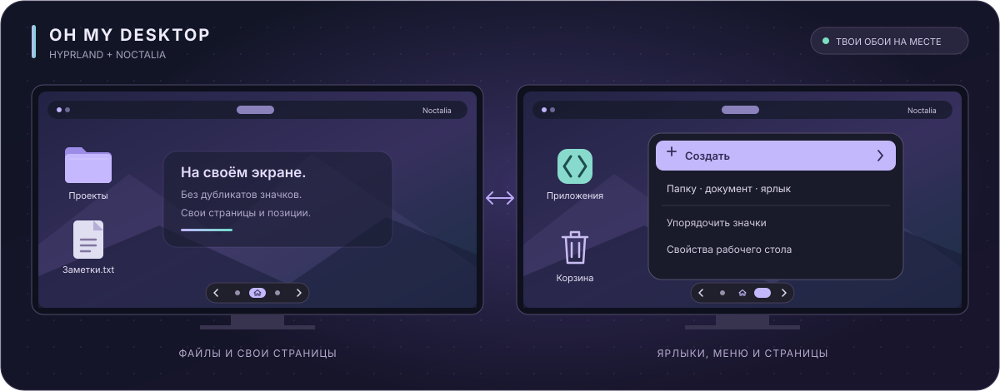

<div align="center">

# Oh My Desktop

**Привычный рабочий стол. Твой Hyprland.**

Файлы, папки, ярлыки и контекстное меню — поверх любимых обоев, рядом с Noctalia и на нужном мониторе.


[](LICENSE)

<br>

**[Возможности](#features)** · **[Быстрый старт](#quick-start)** · **[Два монитора](#monitors)** · **[Вопросы](#faq)**

<sub>Доработанная версия EduuG/oh-my-desktop для CachyOS, Hyprland и Noctalia.</sub>

<br>



<sub>Иллюстрация возможностей. Реальные цвета зависят от темы пользователя.</sub>

</div>

---

<a id="features"></a>

## ✨ Рабочий стол, которым удобно пользоваться

| | Возможность |
|:---:|---|
| 📁 | **Настоящие файлы и папки.** Рабочий стол использует каталог из XDG user-dirs. Изменения в файловом менеджере появляются и на экране. |
| 🖱️ | **Знакомое управление.** Двойной щелчок, выделение нескольких объектов, переименование и перетаскивание по сетке. |
| ➕ | **Создание через ПКМ.** Новая папка, текстовый документ или ярлык приложения с выбором из установленного ПО. |
| 🖥️ | **Отдельная раскладка на каждом экране.** Значок принадлежит одному монитору, переносится на другой и запоминает положение. |
| 🎨 | **Оформление под тему.** Контекстное меню и свойства используют системную палитру Qt и цвета из `kdeglobals`. |
| 🌌 | **Обои остаются видны.** Прозрачные Layer Shell-поверхности размещаются над фоном и ниже верхних панелей. |
| 🗑️ | **Корзина.** Открытие в Dolphin, перемещение объектов в корзину и обновление значка при изменении её состояния. |
| 🛡️ | **Защитные файловые операции.** Проверка содержимого, обработка конфликтов имён и сохранение резервных копий при замене или переносе между файловыми системами. |
| 🔎 | **Настройка под себя.** Размер значков, шрифт, миниатюры, скрытые файлы, сортировка и сброс настроек формы к значениям по умолчанию. |
| ◉ | **Страницы на каждом мониторе.** Независимые наборы значков, порядок страниц, активная страница и позиции сохраняются. Переключатель снизу подстраивается под тему. |
| 🇷🇺 | **Русский интерфейс.** Основные меню, свойства, страницы и выбор ярлыков локализованы. |

### Noctalia продолжает отвечать за оформление

Oh My Desktop добавляет слой значков. Обои и панели остаются под управлением Noctalia. Приложение не переписывает её настройки, конфигурацию мониторов или драйвера.

Совместное размещение значков и интерактивных Desktop Widgets в одной области отдельно не гарантируется: учитывайте, какой слой должен получать клики мыши.

---

<a id="monitors"></a>

## 🖥️ Каждому экрану — свои значки

**Одна папка рабочего стола. Разное расположение объектов на мониторах.**

- Папка или документ, созданные через меню рабочего стола, появляются на экране создания.
- Ярлыки приложений из свойств появляются на активной странице активного монитора. Через «Создать → Ярлык приложения» — на странице и у места вызова контекстного меню.
- Файлы, добавленные в каталог рабочего стола извне, по умолчанию появляются на основном экране.
- Перетаскивание между мониторами меняет размещение значка; сам файл остаётся в общей папке рабочего стола.
- При перезапуске приложения и следующем входе в сеанс раскладка загружается из настроек.
- Если монитор отключён, его значки временно показываются на доступном экране. Сохранённая привязка к отсутствующему монитору остаётся.

В текущей версии основным считается `DP-1`, если он подключён; иначе используется основной экран Qt. Для другой конфигурации задайте имя явно:

```bash
OMD_PRIMARY_MONITOR=HDMI-A-1 QT_QPA_PLATFORM=wayland ./build/oh-my-desktop
```

Имена подключённых выходов можно посмотреть командой `hyprctl monitors`.

---

### Страницы значков

В **Свойствах рабочего стола → Страницы** выберите монитор. Редактор открывается каруселью экранчиков с основной страницей по центру: нажимайте соседний экран, листайте колесом или свайпом мыши; кнопка **К основной** возвращает к главной. Карточки **+** по краям добавляют страницы слева и справа. Название выбранной страницы меняется под каруселью, а кнопки **← / →** в строке «Порядок» меняют соседние страницы местами. Изменения сохраняются через **Применить / ОК**; отмена не применяет правки. Поддерживается до 64 страниц на монитор. Основную страницу удалить нельзя. Удаление другой страницы возвращает её значки на основную и не удаляет файлы.

- Нажимайте точки или стрелки внизу по центру. Основная страница отмечена домиком — он виден и на активной плашке, и при выборе другой страницы. Колесо над переключателем тоже листает страницы: вверх — вправо, вниз — влево; прокрутка зациклена: после последней страницы открывается первая, а перед первой — последняя.
- Перетащите значок на точку нужной страницы либо используйте **ПКМ по значку → Переместить на страницу…**, в том числе на другом мониторе.
- Новая папка или документ появляются на текущей странице текущего монитора. Внешние файлы по умолчанию появляются на основной странице главного монитора. Ярлыки приложений из свойств создаются на активной странице активного монитора; из контекстного меню — на исходной странице у точки щелчка, с привязкой к свободной ячейке сетки.
- **ПКМ в Dolphin → Создать ярлык на рабочем столе** добавляет ссылку на активную страницу активного монитора. Пункт появляется вместе с приложением и исчезает при его остановке; перезапускать Dolphin не нужно.
- Это страницы значков: они не переключают рабочие пространства Hyprland и не перемещают окна приложений. В Dolphin все реальные файлы рабочего стола остаются видны вместе.
- Старые позиции автоматически остаются на странице «Основная». Идентификаторы страниц стабильны при переименовании и перестановке. При отключении монитора его значки временно видны на основной странице главного экрана; исходное назначение сохраняется.

Для горячей клавиши нужен запущенный менеджер значков. Управляющий сокет в `$XDG_RUNTIME_DIR` доступен только текущему пользователю; опроса Hyprland в фоне нет. Приложение отслеживает активный монитор через существующее IPC-соединение, поэтому помощник не запускает `hyprctl` при каждом щелчке. Пример для существующего файла Lua с биндами (сначала проверьте, что сочетание свободно):

```lua
hl.bind("SUPER + SHIFT + mouse_up", hl.dsp.exec_cmd("/home/coder/.local/bin/oh-my-desktop-pages next"))
hl.bind("SUPER + SHIFT + mouse_down", hl.dsp.exec_cmd("/home/coder/.local/bin/oh-my-desktop-pages previous"))
```

Замените `/home/coder` своим домашним каталогом. Если в конфигурации CachyOS `Win + Shift + колесо` уже переносит окна между мониторами, замените эти два бинда перед добавлением примера, чтобы действия не пересекались. Вручную: `oh-my-desktop-pages previous`, `next`, `main` или `status`; вторым аргументом можно указать монитор, например `oh-my-desktop-pages status DP-1`. Для диагностики без анимации задайте `OMD_NO_ANIMATIONS=1` при запуске программы.

<a id="quick-start"></a>

## 🚀 Быстрый старт

### Что понадобится

| Компонент | Назначение |
|---|---|
| Linux + Wayland + Hyprland | Сеанс и IPC композитора |
| Компилятор с C++17, CMake 3.20+, Make или Ninja | Сборка |
| Qt6 Core, Gui, Widgets и Network | Интерфейс |
| LayerShellQt | Поверхности Wayland Layer Shell |
| Python 3 | Проверяемые файловые операции и открытие ссылок на отключённые диски |
| `udisks2`, `util-linux`, агент polkit | Подключение диска при открытии недоступного ярлыка (необязательно) |
| `xdg-utils`, `xdg-user-dirs` | Открытие файлов и каталог рабочего стола |
| Dolphin | Открытие корзины и виртуального пункта «Этот компьютер» |
| Тема значков и поддержка SVG в Qt | Отображение значков; при отсутствии темы используется Breeze |

Noctalia не является библиотечной зависимостью приложения. Совместная работа проверялась с её обоями и панелями.

### 1. Собрать

Откройте терминал в папке исходников:

```bash
cmake -S . -B build -DCMAKE_BUILD_TYPE=Release
cmake --build build --parallel 2
```

Результат — `build/oh-my-desktop` и расположенные рядом помощники `build/safe_transfer.py`, `build/open_shortcut.py`, `build/desktop_pages.py` и `build/send-to-desktop.py`. Сохраняйте их вместе с приложением.

### 2. Сначала проверить на отдельном каталоге

Примеры с переменными ниже написаны для Bash. Если используете Fish, сначала выполните `bash`.

Перед тестом остановите уже работающую копию менеджера значков, чтобы два приложения не рисовали рабочий стол одновременно.

```bash
demo_dir="$(mktemp -d -t oh-my-desktop-demo.XXXXXX)"
mkdir -p "$demo_dir/Desktop" "$demo_dir/config" "$demo_dir/data" "$demo_dir/state"

env QT_QPA_PLATFORM=wayland \
    OMD_DESKTOP_DIR="$demo_dir/Desktop" \
    XDG_CONFIG_HOME="$demo_dir/config" \
    XDG_DATA_HOME="$demo_dir/data" \
    XDG_STATE_HOME="$demo_dir/state" \
    ./build/oh-my-desktop
```

Это отдельная папка с отдельными настройками. Для остановки нажмите **Ctrl+C** в этом терминале.

### 3. Запустить с настоящим рабочим столом

Узнайте используемый каталог и предварительно сохраните его резервную копию:

```bash
xdg-user-dir DESKTOP
```

После проверки запустите приложение в обычном окружении:

```bash
QT_QPA_PLATFORM=wayland ./build/oh-my-desktop
```

Без `OMD_DESKTOP_DIR` каталог выбирается через Qt из настроек XDG. Папки открываются через `xdg-open`; для работы через Dolphin выберите его файловым менеджером по умолчанию.

<details>
<summary><b>Локальная установка без sudo</b></summary>

<br>

После успешного теста можно разместить приложение и помощники в пользовательском каталоге. Перед заменой установленной версии остановите её.

```bash
install -d "$HOME/.local/opt/oh-my-desktop" "$HOME/.local/bin"
install -m 755 build/oh-my-desktop "$HOME/.local/opt/oh-my-desktop/oh-my-desktop"
install -m 644 build/safe_transfer.py "$HOME/.local/opt/oh-my-desktop/safe_transfer.py"
install -m 644 build/open_shortcut.py "$HOME/.local/opt/oh-my-desktop/open_shortcut.py"
install -m 755 build/desktop_pages.py "$HOME/.local/bin/oh-my-desktop-pages"
install -m 644 build/send-to-desktop.py "$HOME/.local/opt/oh-my-desktop/send-to-desktop.py"

QT_QPA_PLATFORM=wayland "$HOME/.local/opt/oh-my-desktop/oh-my-desktop"
```

У проекта пока нет готового установщика и CMake-цели `install`. Эти команды копируют только приложение и его Python-помощники.

</details>

<details>
<summary><b>Автозапуск в Hyprland</b></summary>

<br>

Автозапуск настраивается вручную после проверки. Сохраните резервную копию конфигурации Hyprland и используйте способ, подходящий вашей версии: Lua или классический конфиг.

Для существующей Lua-конфигурации вызов запуска добавляется в её обработчик старта:

```lua
-- Замените путь на абсолютный путь к установленному бинарнику.
hl.exec_cmd("env QT_QPA_PLATFORM=wayland /absolute/path/to/oh-my-desktop")
```

Запускайте менеджер значков после оболочки и её панелей, чтобы приложение получило корректные отступы. Второй экземпляр добавлять не нужно.

Локальные скрипты управления, пользовательская systemd-служба и сервисное меню Dolphin из персональной настройки автора в этот снимок исходников не включены.

</details>

---

## 🛡️ Файлы важнее удобного удаления

Файловые операции выполняет отдельный Python-помощник `safe_transfer.py`. Он проверяет содержимое и метаданные, учитывает скрытые файлы и символические ссылки и завершает перенос атомарным переименованием без перезаписи неожиданно появившегося объекта.

| Ситуация | Поведение |
|---|---|
| Совпало имя | Приложение предлагает обработать конфликт. Существующий объект не заменяется молча. |
| Подтверждена замена | Предыдущий объект сохраняется в `.omd-recovery-*` рядом с местом назначения. |
| Перенос на другую файловую систему | Копия проверяется; исходный объект сохраняется в `.omd-recovery-*` рядом с исходным расположением. |
| Изменение источника во время проверки | Операция останавливается с ошибкой. |
| Неподдерживаемый специальный файл | Операция отклоняется. |
| Удаление обычного ярлыка-ссылки | В корзину отправляется ссылка, а исходная папка или установленное приложение остаются на месте. |

Реестр сохранённых копий:

```text
~/.local/state/oh-my-desktop/recovery.jsonl
```

При заданном `XDG_STATE_HOME` используется его каталог. Папки `.omd-recovery-*` **не очищаются автоматически**. Проверяйте их содержимое и удаляйте вручную только после проверки нужных файлов. Эти копии не заменяют отдельное резервное копирование.

Передача больших каталогов выполняется синхронно и может временно задерживать интерфейс. Для тяжёлых копирований удобнее использовать Dolphin.

Пути с символическими ссылками в родительских каталогах помощник отклоняет. Для таких расположений используйте файловый менеджер.

---

## ⌨️ Управление

| Действие | Как выполнить |
|---|---|
| Открыть файл, папку или ярлык | Двойной щелчок или **Enter** |
| Открыть меню | **ПКМ** по значку или пустому месту |
| Выделить несколько объектов | **Ctrl + щелчок** или рамка выделения |
| Перенести значок на другой монитор | Перетащить мышью |
| Переименовать | Контекстное меню значка |
| Переместить в корзину | **Delete** или пункт меню |
| Копировать / вырезать / вставить | **Ctrl+C / Ctrl+X / Ctrl+V** |
| Изменить размер значков | **Ctrl + колесо мыши** или свойства |
| Перемещать выделение | Клавиши со стрелками |
| Найти значок по начальной букве | Набор буквы на клавиатуре |

---

## 🧩 Под капотом

| Компонент | За что отвечает |
|---|---|
| `DesktopWindow` | Прозрачная поверхность `LayerBottom` для каждого монитора |
| `DesktopScene` | Файлы, сетка, выделение, меню и взаимодействие со значками |
| `DesktopLayout` | Привязка объектов к мониторам и сохранение раскладки |
| `DesktopIcon` | Ярлыки `.desktop`, подписи, миниатюры и масштабирование значков |
| `InlineMenu` | Меню внутри поверхности рабочего стола |
| `TrashMonitor` | Событийное обновление состояния корзины |
| `desktoplayout.cpp`, `desktopscene_pages.cpp` | Страницы, назначение мониторов, сохранение позиций и анимация |
| `pagepager.cpp`, `pagesettings.cpp`, `pagecarousel.cpp` | Переключатель, редактор и анимированная карусель страниц |
| `pagecontrol.cpp`, `desktop_pages.py` | Локальный IPC и горячие клавиши |
| `dolphinintegration.cpp`, `send_to_desktop.py` | Пункт меню Dolphin, жизненный цикл и размещение ярлыков на активной странице |
| `safe_transfer.py` | Проверки копирования, перемещения и резервные копии |

Данные приложения находятся в `$XDG_CONFIG_HOME/Oh My Desktop/Oh My Desktop/`, по умолчанию:

```text
~/.config/Oh My Desktop/Oh My Desktop/
├── monitor-layout.ini              # монитор, страница, порядок и активная страница
├── icon-positions-DP-1.ini          # координаты по страницам и параметры экрана
└── icon-positions-HDMI-A-1.ini
```

Названия файлов позиций зависят от имён подключённых мониторов.

### Что проверялось

- Раздельные значки на двух мониторах, перенос в обе стороны и сохранение позиций после перезапуска.
- Удаление виртуального экрана Qt без падения при сохранении настроек.
- Apply / Cancel / сброс в свойствах, прозрачность при изменении размера и отсутствие «призрачной» корзины.
- Файловые конфликты, скрытые файлы, ссылки и перенос между файловыми системами.
- Страницы на двух мониторах: добавление, перестановка, отмена, перенос значков, создание папки на активной странице и возврат с удалённой страницы.
- Сохранение активной страницы, порядка, монитора и позиций после перезапуска процесса; прозрачность анимации и отсутствие работающей анимации после её завершения.
- Создание ярлыков приложений: активный монитор/страница из свойств и исходная точка контекстного меню, даже после переключения страницы во время выбора.
- Доверие KDE к пункту меню Dolphin и его фактический запуск в изолированной D-Bus-сессии: ссылка создаётся на нужной странице, оригинал сохраняется.
- Управляющий сокет, отдельные группы запуска приложений и сохранение процессов при обновлении менеджера значков.

Среда ручной проверки: **CachyOS · Hyprland 0.56.2 с Lua · Noctalia 5.4.0 · NVIDIA RTX 2060 Super · два экрана 1920×1080**. Это проверенная конфигурация, а не требование установить именно такие версии.

Тесты файловых операций можно запустить из корня проекта:

```bash
XDG_STATE_HOME="$(mktemp -d -t omd-tests.XXXXXX)" python3 tests/test_safe_transfer.py
```

Тесты страниц с виртуальными мониторами и перезапуском процесса включаются через `-DOMD_BUILD_PROPERTIES_CHECK=ON` и запускаются командой `ctest --test-dir build -R desktop_pages --output-on-failure`. Они используют только временные каталоги и Qt offscreen.

Дополнительные изолированные Qt-проверки находятся в [`tests/`](tests/). Они собираются опциями `OMD_BUILD_PROPERTIES_CHECK` и `OMD_BUILD_MENU_PREVIEW`; для проверки свойств нужны приватные заголовки Qt той же версии.

---

<a id="faq"></a>

## ❔ Частые вопросы

**Это замена Noctalia или Dolphin?**

Это менеджер значков. Noctalia продолжает управлять оформлением, а Dolphin — открывать папки и корзину.

**Что происходит с ярлыком на отключённом диске?**

Символическая ссылка остаётся на своём экране и на прежнем месте, с отметкой замка. При открытии программа пытается найти единственный подходящий диск по метке или UUID в пути `/run/media/$USER/...` и подключить его через UDisks с обычной авторизацией polkit. Автоматического подключения при запуске нет. При отмене, отсутствии диска или неоднозначном имени ссылка сохраняется. Для других путей, зашифрованных томов, изменившихся точек монтирования и ошибок прав подключите диск через Dolphin. Отметка доступности обновляется примерно за три секунды.

**Если удалить ярлык приложения, само приложение пропадёт?**

При удалении созданного здесь `.desktop`-ярлыка удаляется только файл ярлыка. Установленный пакет приложения не удаляется. Если же выбрать настоящую папку или файл, в корзину отправится выбранный объект.

**На мониторах разные папки рабочего стола?**

Каталог общий. Между экранами распределяются значки, без создания копий файлов.

**Как работает пункт «Создать ярлык на рабочем столе» в Dolphin?**

Он встроен в приложение. При запуске менеджер публикует собственный пункт меню в `$XDG_DATA_HOME/kio/servicemenus/` (по умолчанию `~/.local/share/kio/servicemenus/`), при штатной остановке удаляет только свой пункт. Файл меню создаётся с правами владельца на чтение, запись и запуск, чтобы Dolphin разрешал выполнять действие. Dolphin подхватывает это при следующем открытии контекстного меню. Пока приложение выключено, пункт отсутствует. Скрипт `send-to-desktop.py` должен лежать рядом с бинарником.

Место назначения фиксируется при вызове: активный монитор и его активная страница. Оригинал остаётся на месте, создаётся символическая ссылка; совпадающие имена, существующие файлы и недоступные ссылки не перезаписываются. Если приложение остановится во время операции, уже созданная ссылка сохраняется. Если оно не запущено до начала операции, скрипт не создаёт новых ссылок.

Для пользовательской службы systemd добавьте очистку после остановки, в том числе аварийной (путь замените своим):

```ini
ExecStopPost=/home/coder/.local/opt/oh-my-desktop/oh-my-desktop --cleanup-dolphin-menu
```

Команда удаляет только собственный пункт завершившегося приложения. Рабочий стол и пользовательские файлы она не удаляет. При ручном запуске обычный Ctrl+C/SIGTERM также убирает пункт. После принудительного SIGKILL вручную запущенной версии используйте эту команду очистки. Для отключения интеграции задайте `OMD_DISABLE_DOLPHIN_MENU=1` перед запуском.

**А горячая клавиша показа рабочего стола?**

Показ рабочего стола через Win + Shift + D остаётся отдельной пользовательской настройкой Hyprland.

**Можно ли переносить значки в любое стороннее окно?**

Перенос между рабочими столами мониторов поддерживается. Произвольный экспорт значков в другие приложения пока не реализован.

**Остановка рабочего стола закроет запущенные приложения?**

В сеансе с systemd и D-Bus приложения запускаются в отдельных пользовательских scope через `systemd-run`. Это отделяет их от группы процессов менеджера рабочего стола. Если устанавливаете собственную службу, для совместимости с уже запущенными старой версией приложениями используйте `KillMode=process` до завершения текущего сеанса. Обычный `startDetached` сам по себе не отделяет процесс от systemd cgroup.

**Как полностью отключить приложение?**

При ручном запуске нажмите **Ctrl+C** в терминале. При автозапуске уберите добавленный вызов запуска и остановите используемую службу или процесс штатным `SIGTERM`. Настройки и файлы рабочего стола сохранятся.

**Как удалить пользовательскую установку из примера?**

После остановки удалите только установленные файлы из примера:

```bash
rm -f "$HOME/.local/opt/oh-my-desktop/oh-my-desktop" \
      "$HOME/.local/opt/oh-my-desktop/safe_transfer.py" \
      "$HOME/.local/opt/oh-my-desktop/open_shortcut.py" \
      "$HOME/.local/bin/oh-my-desktop-pages" \
      "$HOME/.local/opt/oh-my-desktop/send-to-desktop.py"
rmdir "$HOME/.local/opt/oh-my-desktop"
```

Каталог рабочего стола, настройки и резервные копии `.omd-recovery-*` эти команды не затрагивают.

---

## ⭐ История звёзд

<div align="center">

<a href="https://www.star-history.com/?repos=MrGlany%2FOh-My-Desktop&type=date&legend=bottom-right">
  <picture>
    <source media="(prefers-color-scheme: dark)" srcset="https://api.star-history.com/chart?repos=MrGlany/Oh-My-Desktop&type=date&legend=bottom-right&theme=dark" />
    <source media="(prefers-color-scheme: light)" srcset="https://api.star-history.com/chart?repos=MrGlany/Oh-My-Desktop&type=date&legend=bottom-right" />
    
  </picture>
</a>

<sub>Нажми на график, чтобы открыть интерактивную статистику.</sub>

</div>

---

## 🤝 Происхождение и лицензия

Проект основан на **[EduuG/oh-my-desktop](https://github.com/EduuG/oh-my-desktop)** из [Classic Hypr Suite](https://github.com/EduuG/classic-hypr-suite). Эта версия развивает исходный менеджер: оформление, локализацию, файловые операции и работу с несколькими мониторами.

Лицензия этой версии указана в файле **[LICENSE](LICENSE) — MIT License**.

MIT разрешает использование, изменение и распространение кода, в том числе в коммерческих проектах, с сохранением уведомления об авторских правах и текста лицензии. Программа предоставляется без гарантий. Авторство исходного проекта указано выше.

---

<div align="center">

**Файлы под рукой. Значки на своих местах.**

Доработки — [MrGlany](https://github.com/MrGlany) · Исходный проект — [EduuG](https://github.com/EduuG)

[Лицензия MIT](LICENSE)

<sub>C++17 · Qt6 · Wayland Layer Shell · Linux</sub>

</div>
